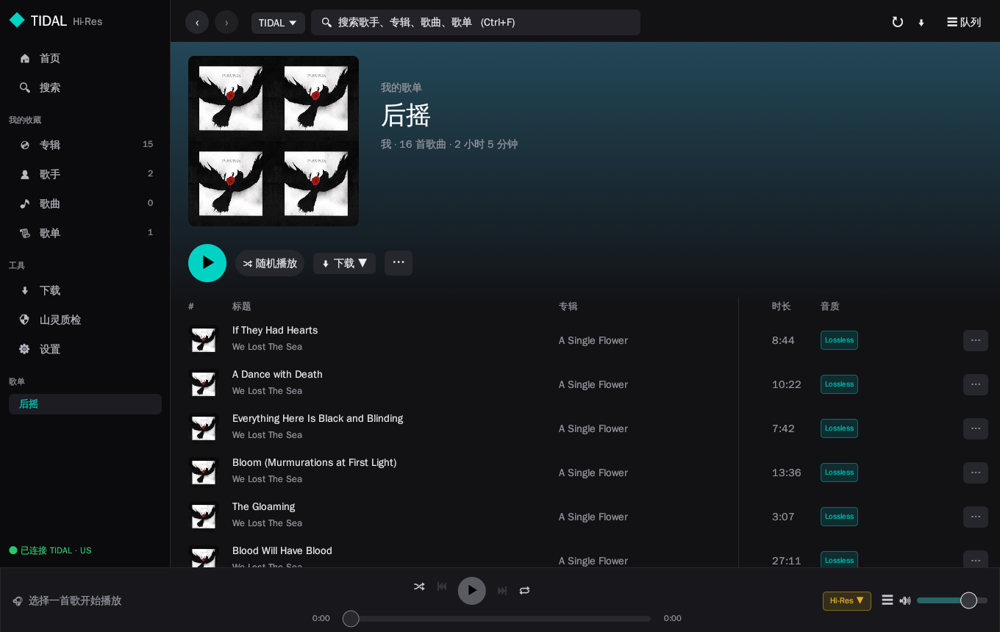
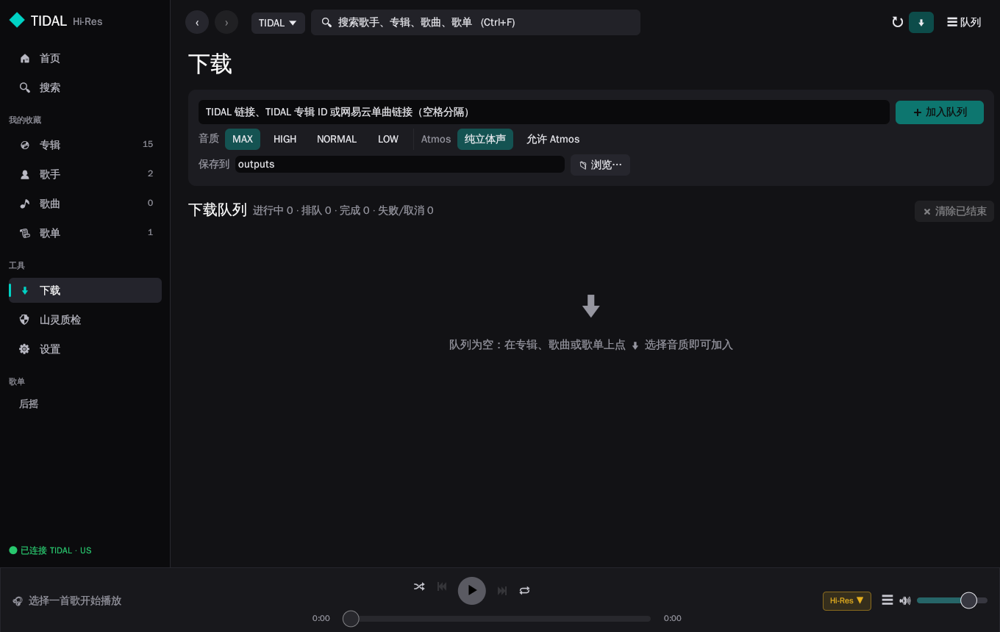
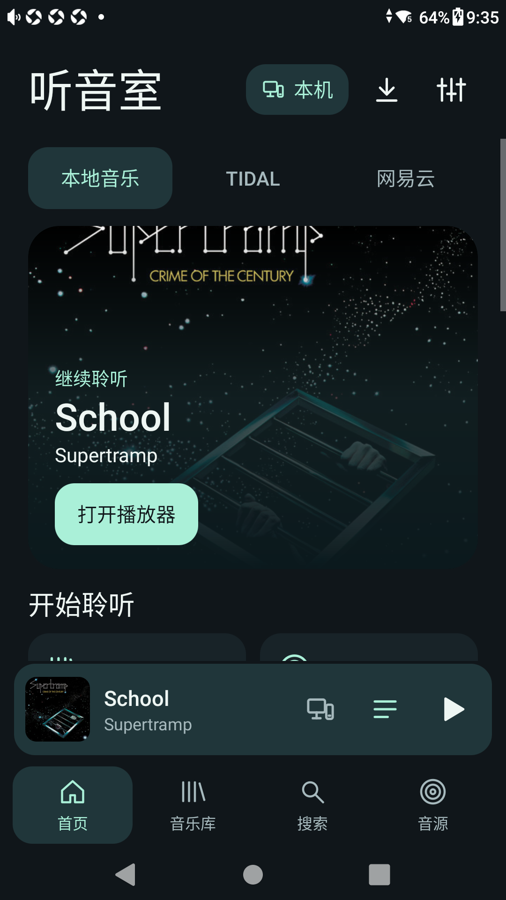
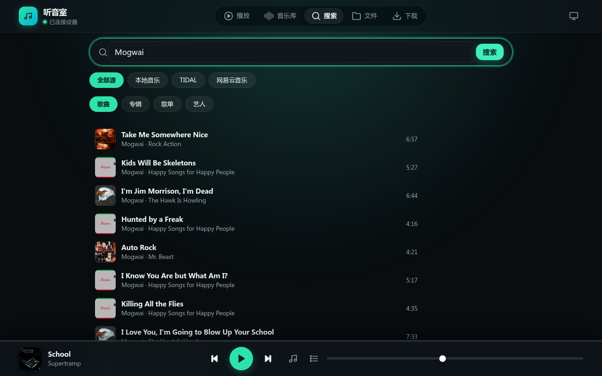

# 听音室 · TIDAL GUI

听音室包含 Linux 桌面播放器、Android 播放器和浏览器遥控。Linux 桌面端可浏览和播放在线音乐，管理下载队列。Android 也可以导入本地音乐，整理音乐库和播放列表。

## 功能与运行截图

以下是 Linux、Android 和 Web 三端的实际运行截图。点击任意截图可查看原图。

### Linux 桌面

浏览 TIDAL 的曲目、专辑、歌手和歌单，管理收藏、播放队列和下载。播放由 mpv 驱动，也可接入网易云兼容服务。下载工具支持通过 FFmpeg 检查本地音频文件。

[](docs/screenshots/linux.png)

| 搜索结果 | 专辑详情 |
| --- | --- |
| [](docs/screenshots/linux-search.png) | [](docs/screenshots/linux-album.png) |

| 歌单详情 | 下载配置 |
| --- | --- |
| [](docs/screenshots/linux-playlist.png) | [](docs/screenshots/linux-downloads.png) |

### Android

导入本地文件，按歌曲、专辑或歌单浏览，用系统媒体控件进行后台播放。配置对应音源后，可搜索 TIDAL 和网易云，查看歌词并选择音质。更多功能和账号设置见 [Android 使用说明](android/README.md)。

| 首页与最近聆听 | 正在播放 | 专辑详情 |
| --- | --- | --- |
| <a href="docs/screenshots/android.png"></a> | <a href="docs/screenshots/android-player.png"></a> | <a href="docs/screenshots/android-album.png"></a> |

| 播放队列 | 收藏专辑 |
| --- | --- |
| <a href="docs/screenshots/android-queue.png"></a> | <a href="docs/screenshots/android-favorites.png"></a> |

### Web 遥控

通过同一局域网遥控 Android 播放器。部署多端后台后，也可用播放器账号在浏览器中选择已连接设备并控制播放、进度和队列。

[](docs/screenshots/web.png)

| 遥控搜索 | 音乐库 |
| --- | --- |
| [](docs/screenshots/web-search.png) | [](docs/screenshots/web-library.png) |

## 运行

### Linux

准备 Rust、mpv、FFmpeg 和可运行 `tiddl` 的 Python 环境。使用封面嵌入功能时，在同一个 Python 环境安装 Mutagen。启用 TIDAL 时在本地运行 `tiddl auth login`，再启动桌面端。

```sh
cargo run --release --locked
```

| 环境变量 | 用途 |
| --- | --- |
| `TIDDL_PATH` | tiddl 会话目录，默认为 `~/.tiddl` |
| `TIDAL_TIDDL_BIN`、`TIDAL_PYTHON` | 指定同一虚拟环境内的 tiddl 和 Python，默认从 PATH 查找 |
| `TIDAL_DOWNLOAD_DIR` | 初始下载目录，默认为 `outputs` |
| `TIDAL_DOWNLOAD_SCRIPT` | 可选的自定义下载脚本，接收 `URL -q 音质 -da Atmos设置 -p 目录` |
| `NETEASE_API_URL` | 可选的网易云兼容 API 基础地址 |
| `TIDAL_ACCOUNT_ORIGIN` | 可选的多端后台 HTTPS 地址，例如 `https://relay.example.com` |

以前的 Linux 播放器账号按原服务使用。升级后，先将 `TIDAL_ACCOUNT_ORIGIN` 指向这些账号原来使用的中继，再执行同步或退出。

### Android

准备 JDK 17、Android SDK Platform 36 和 Build Tools 35.0.0，设置 `ANDROID_HOME` 后运行：

```sh
cd android
./gradlew :app:assembleDebug
```

APK 位于 `android/app/build/outputs/apk/debug/`。构建默认提供本地播放，可在音源设置中配置可用的在线服务。为自托管版本配置播放器账号、默认网易云入口、TIDAL 授权代理及应用内更新时，可将 `tidalRelayOrigin=https://relay.example.com` 写入本机 `~/.gradle/gradle.properties`。该地址会编入 APK，公开发行时用未配置该属性的构建环境。

### 多端后台

后台使用 Python 标准库，通过反向代理提供 HTTPS。参考 [多端后台部署](backend/README.md) 配置域名、设备和凭据。第三方音源的可用功能和音质取决于账号权限、服务配置和曲目。

## 发布前检查

用示例域名和独立演示配置编写文档及截图。提交前检查 Git 暂存区，确认个人域名、用户名、设备标识、账号数据库、下载文件、会话和签名材料均留在本地。对拟发的 APK 和桌面二进制也执行同样的检查。发布桌面二进制时，使用无个人路径的构建环境，或剥离调试信息并使用 Rust 的 `--remap-path-prefix`。
