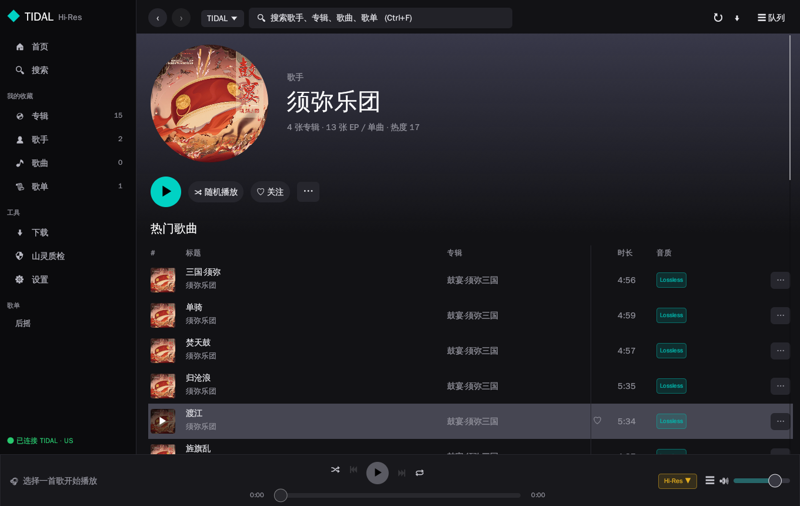
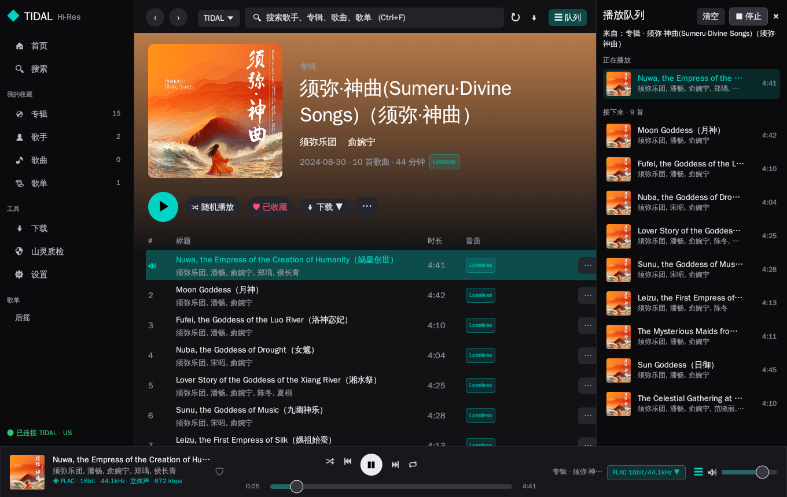
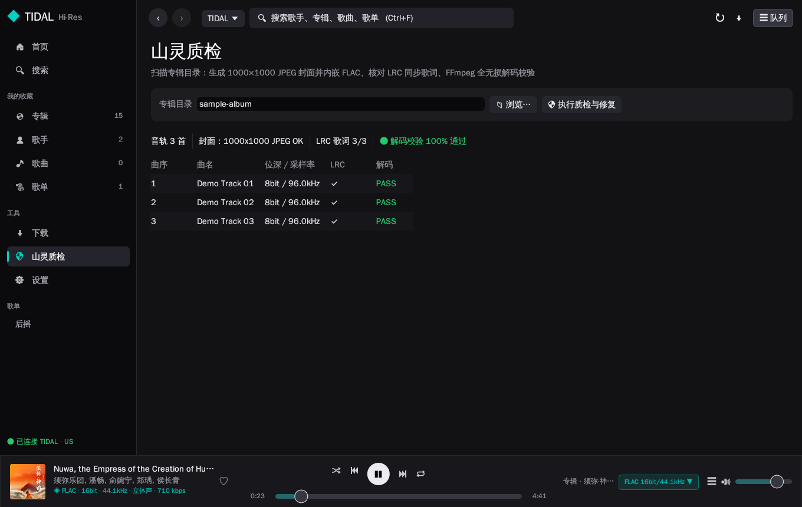
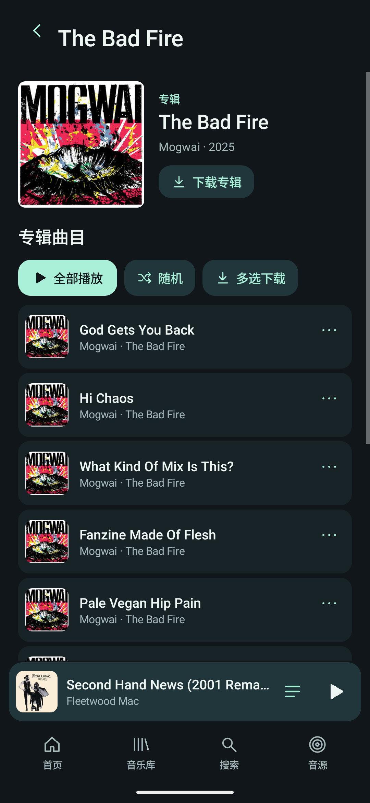
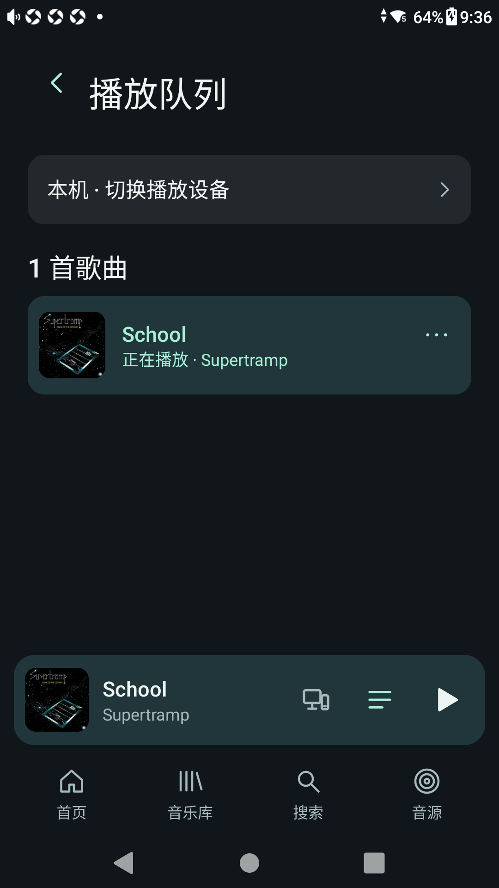
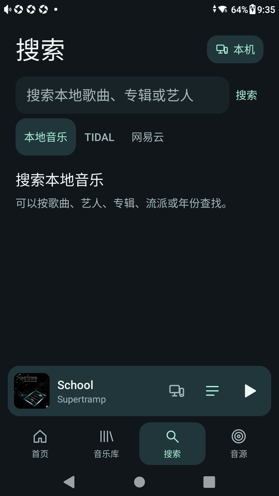
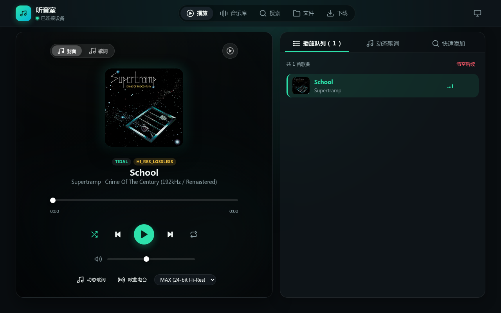
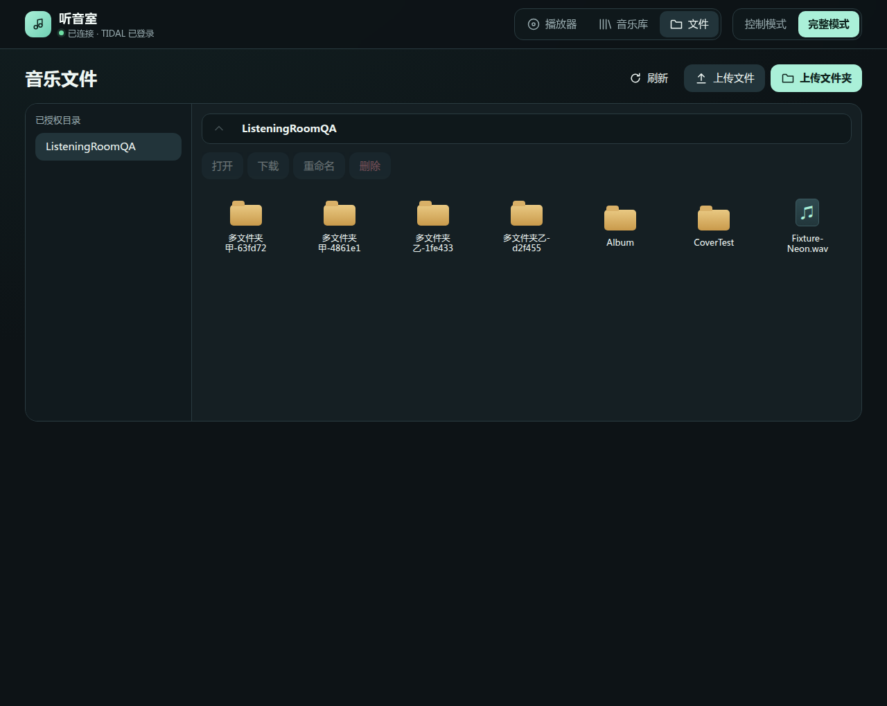
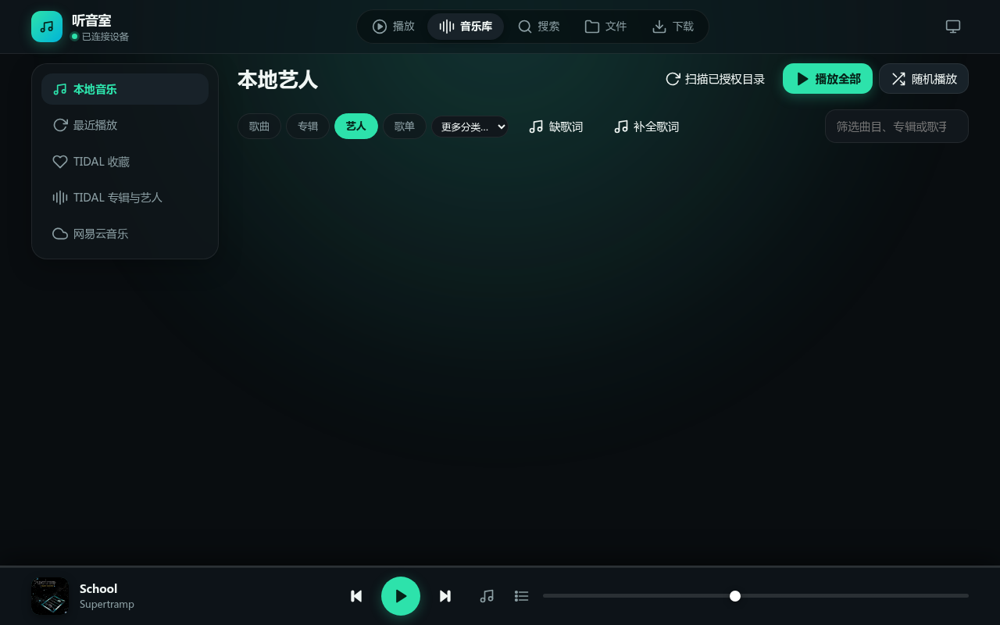

# 听音室 · TIDAL GUI

听音室是一套专为无损/高解析音乐发烧友打造的多端音频播放与生态系统，包含 **Linux 桌面端**、**Android 原生播放器**（特别针对山灵等发烧 DAP 播放器优化）以及**现代化 Web 局域网/公网遥控端**。系统打通了 TIDAL、网易云、本地无损曲库与 NAS 网络存储，支持无损点播、跨设备控制、智能歌词补全与远程高音质下载。

## 核心特性全景

### 📱 Android 播放器（Hi-Fi & DAP 专属）
- **高保真音频引擎**：原生音频解码与后台播放，支持源码输出，无缝播放（Gapless）与系统媒体控件集成。
- **本地深度曲库索引**：递归扫描 SAF 授权存储，精准解析 FLAC/WAV/DSD 等无损标签（艺人、专辑、碟号、曲号、年份、流派）与内嵌封面。
- **智能歌词补全系统（`LyricsFill`）**：
  - 自动扫描本地缺失歌词曲目；
  - 跨 TIDAL 与网易云双源检索，具备繁简自动转换、歌曲时长（±3s）容差智能比对与同专辑权重算法；
  - 自动生成同名 `.lrc` 文件持久化保存至歌曲同级目录，支持一键批量补全与单曲手动挑选预览。
- **多端设备互联与局域网服务（`LanRemote`）**：
  - 内置高性能轻量 HTTP 遥控服务器，支持 6 位 PIN 码安全快速配对；
  - 跨设备播放器账号互联，支持在不同设备间无缝切换遥控目标与队列同步。
- **网络存储流媒体（新增）**：
  - 内置 SMB (`jcifs-ng`) 与 WebDAV 客户端，支持挂载家庭 NAS / 私有云无损音乐库。

### 🌐 Web 遥控端（现代化 Native 交互体验）
- **原生应用级界面**：暗色玻璃拟态美学设计，深度适配电脑宽屏与手机触屏窄屏布局。
- **跨平台聚合搜索**：
  - 支持“歌曲 / 专辑 / 歌单 / 艺人”四大独立分类；
  - 支持在 TIDAL 在线、网易云音乐与 DAP 本地曲库之间无缝切换检索。
- **独立远程下载管理中心**：
  - 实时显示当前下载速率（MB/s）与剩余时间；
  - 智能按专辑分组折叠显示，单曲/多选批量重试、取消与清理；
  - 展开查看完整音频元数据（格式、码率、采样率、位深、时长、存储路径等）；
  - 支持直接将 TIDAL 专辑一键“整张下载到播放器”。
- **全功能控制台**：远程点歌、音量调节、循环模式、实时动态歌词同步滚动与全屏播放模式。

### 🖥️ Linux 桌面端
- **高性能 GUI**：基于 Rust + egui 构建，极低资源占用。
- **多音源浏览与点播**：mpv 原生音频核心驱动，集成 TIDAL 与网易云兼容源，支持收藏与队列管理。
- **山灵专属下载与质检**：基于 FFmpeg 的音频完整性校验，内置山灵 DAP 规范适配（1000×1000 JPEG 封面、标准分盘目录）。
- **多端设备中继协同**：可直接查看、借用登录并遥控 Android 播放器。

## 功能与运行截图

以下是 Linux、Android 和 Web 三端的实际运行截图。点击任意截图可查看原图。

### Linux 桌面

浏览 TIDAL 的曲目、专辑、歌手和歌单，管理收藏、播放队列和下载。播放由 mpv 驱动，也可接入网易云兼容服务。下载工具支持通过 FFmpeg 检查本地音频文件。

[](docs/screenshots/linux.png)

| 搜索结果 | 专辑详情 |
| --- | --- |
| [](docs/screenshots/linux-search.png) | [](docs/screenshots/linux-album.png) |

| 歌单详情 | 下载配置 |
| --- | --- |
| [](docs/screenshots/linux-playlist.png) | [](docs/screenshots/linux-downloads.png) |

| 艺人主页与热门歌曲 | 正在播放与队列 |
| --- | --- |
| [](docs/screenshots/linux-artist.png) | [](docs/screenshots/linux-queue.png) |

| 山灵质检报告（使用测试音轨） |
| --- |
| [](docs/screenshots/linux-qa.png) |

### Android

导入本地文件，按歌曲、专辑或歌单浏览，用系统媒体控件进行后台播放。支持本地曲库智能歌词补全（联动 TIDAL 与网易云，繁简转换与时长智能比对，自动保存同名 `.lrc` 歌词文件）。配置对应音源后，可搜索 TIDAL 和网易云，查看歌词并选择音质。并已拓展 SMB / WebDAV 网络存储流媒体支持。更多功能和账号设置见 [Android 使用说明](android/README.md)。

| 首页与最近聆听 | 正在播放 | 专辑详情 |
| --- | --- | --- |
| <a href="docs/screenshots/android.png"></a> | <a href="docs/screenshots/android-player.png"></a> | <a href="docs/screenshots/android-album.png"></a> |

| 播放队列 | 收藏专辑 |
| --- | --- |
| <a href="docs/screenshots/android-queue.png"></a> | <a href="docs/screenshots/android-favorites.png"></a> |

| 在线搜索结果 | 本地音乐库 |
| --- | --- |
| <a href="docs/screenshots/android-search.png"></a> | <a href="docs/screenshots/android-local.png"></a> |

### Web 遥控

通过同一局域网遥控 Android 播放器。部署多端后台后，也可用播放器账号在浏览器中选择已连接设备并控制播放、进度和队列。支持在 Web 端直接触发将 TIDAL 专辑下载至 Android 播放器，并在专属的“下载”页实时监控速率、剩余时间与音轨详情。本地音乐支持一键检测缺歌词并跨源补全。

桌面端和 Android 登录同一播放器账号后，也可在应用内的 **设备** 页查看所有客户端并选择一台遥控。设备切换按钮常驻在桌面端顶栏和 Android 主页面标题栏。选择设备后，播放条、正在播放、播放队列沿用本机界面，改为显示和控制所选设备。遥控 Android 设备时，音乐库也换成该设备的本地音乐。如果本机没有登录 TIDAL，而所选设备已登录，本机会借用它的登录浏览 TIDAL，下载也在该设备进行，下载页显示该设备的下载任务。借用登录可在被借用设备的 **设置 › 播放器账号** 中用“允许我的其他设备借用本机的 TIDAL 登录”关闭（默认开启）；关闭后仍可遥控它下载。

[](docs/screenshots/web.png)

| 遥控聚合搜索 | 手机下载管理看板 |
| --- | --- |
| [](docs/screenshots/web-search.png) | [](docs/screenshots/web-downloads.png) |

| 音乐库与缺歌词筛选 | 已授权音乐目录与文件管理 |
| --- | --- |
| [](docs/screenshots/web-library.png) | [](docs/screenshots/web-files.png) |

| 艺人分类 |
| --- |
| [](docs/screenshots/web-artists.png) |

## 运行

### Linux

准备 Rust、mpv、FFmpeg 和可运行 `tiddl` 的 Python 环境。使用封面嵌入功能时，在同一个 Python 环境安装 Mutagen。启用 TIDAL 时在本地运行 `tiddl auth login`，再启动桌面端。

```sh
cargo run --release --locked
```

| 环境变量 | 用途 |
| --- | --- |
| `TIDDL_PATH` | tiddl 会话目录，默认为 `~/.tiddl` |
| `TIDAL_TIDDL_BIN`、`TIDAL_PYTHON` | 指定同一虚拟环境内的 tiddl 和 Python，默认从 PATH 查找 |
| `TIDAL_DOWNLOAD_DIR` | 初始下载目录，默认为 `outputs` |
| `TIDAL_DOWNLOAD_SCRIPT` | 可选的自定义下载脚本，接收 `URL -q 音质 -da Atmos设置 -p 目录` |
| `NETEASE_API_URL` | 可选的网易云兼容 API 基础地址 |
| `TIDAL_ACCOUNT_ORIGIN` | 可选的多端后台 HTTPS 地址，例如 `https://relay.example.com` |

以前的 Linux 播放器账号按原服务使用。升级后，先将 `TIDAL_ACCOUNT_ORIGIN` 指向这些账号原来使用的中继，再执行同步或退出。

### Android

准备 JDK 17、Android SDK Platform 36 和 Build Tools 35.0.0，设置 `ANDROID_HOME` 后运行：

```sh
cd android
./gradlew :app:assembleDebug
```

APK 位于 `android/app/build/outputs/apk/debug/`。构建默认提供本地播放，可在音源设置中配置可用的在线服务。为自托管版本配置播放器账号、默认网易云入口、TIDAL 授权代理及应用内更新时，可将 `tidalRelayOrigin=https://relay.example.com` 写入本机 `~/.gradle/gradle.properties`。该地址会编入 APK，公开发行时用未配置该属性的构建环境。

### 多端后台

后台使用 Python 标准库，通过反向代理提供 HTTPS。参考 [多端后台部署](backend/README.md) 配置域名、设备和凭据。第三方音源的可用功能和音质取决于账号权限、服务配置和曲目。

## 发布前检查

用示例域名和独立演示配置编写文档及截图。提交前检查 Git 暂存区，确认个人域名、用户名、设备标识、账号数据库、下载文件、会话和签名材料均留在本地。对拟发的 APK 和桌面二进制也执行同样的检查。发布桌面二进制时，使用无个人路径的构建环境，或剥离调试信息并使用 Rust 的 `--remap-path-prefix`。
