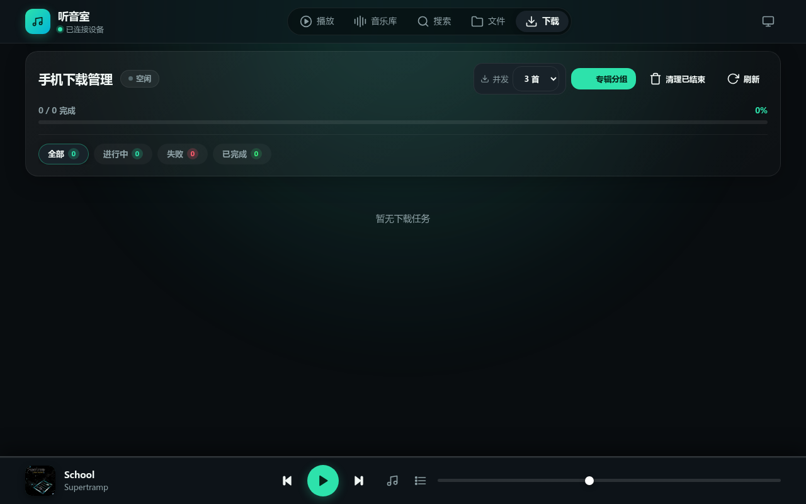
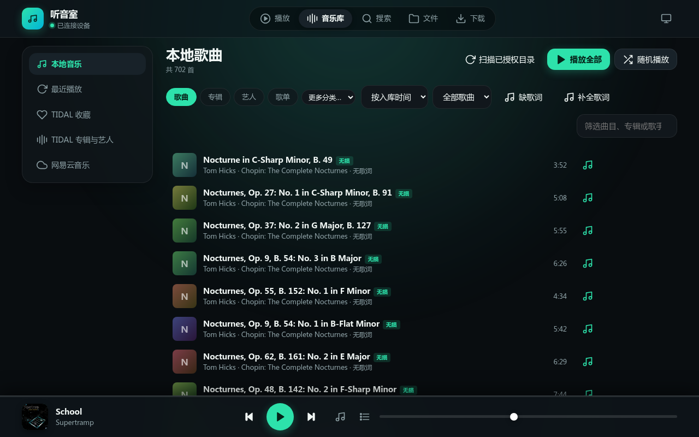
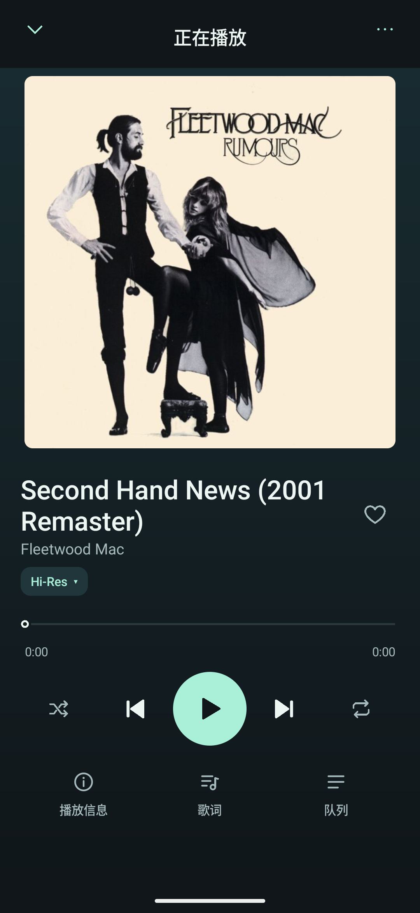
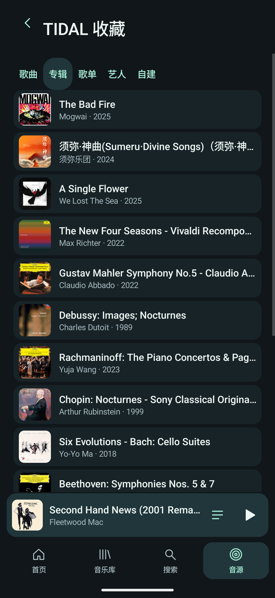
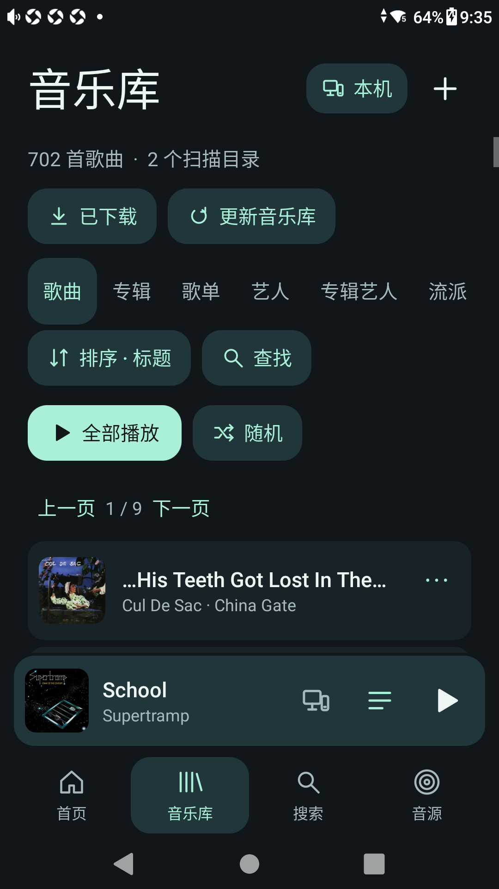
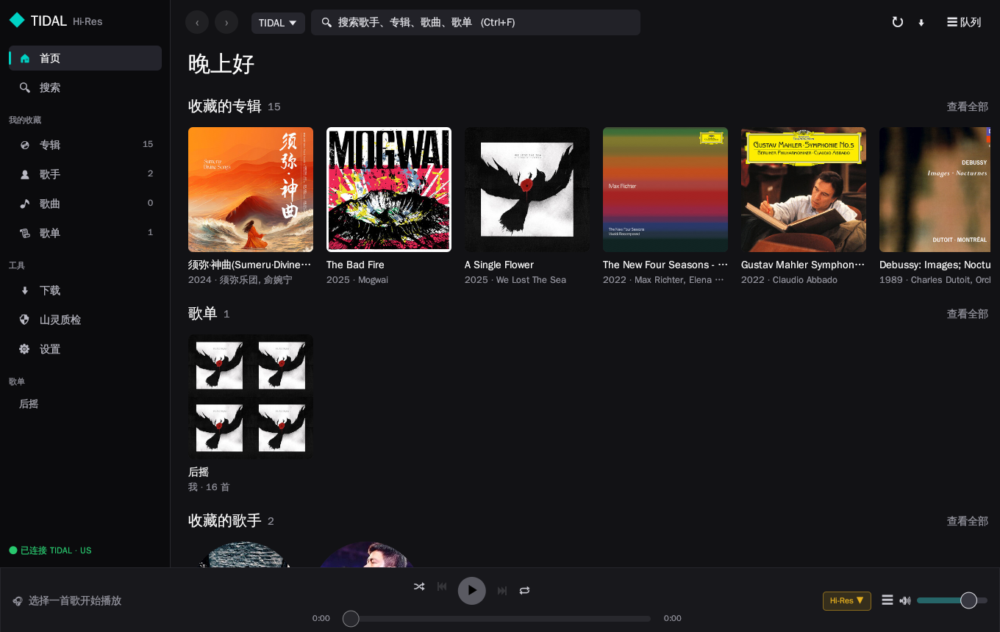
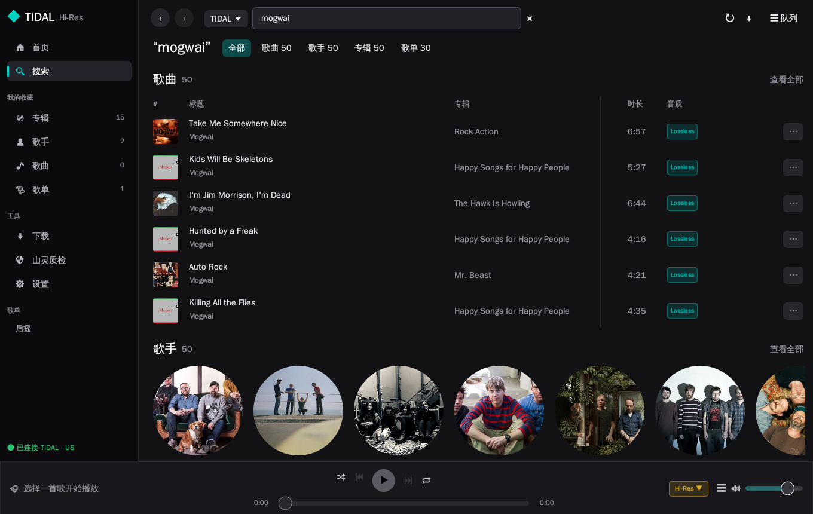
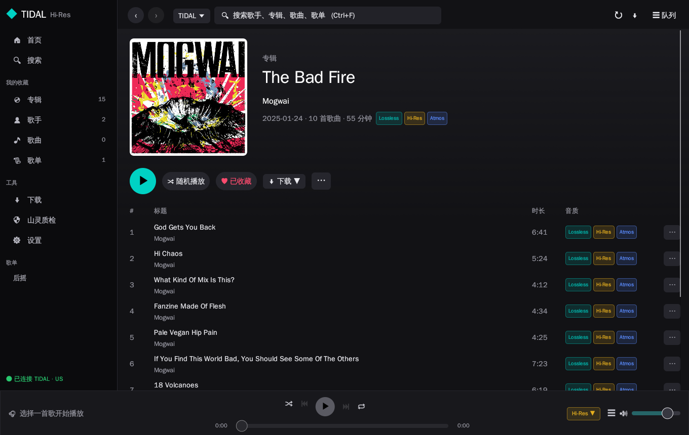

# 听音室 · TIDAL GUI & Hi-Fi Ecosystem

<p align="center">
  <strong>专为无损/高解析音乐发烧友打造的多端音频播放、曲库治理与远程生态系统</strong>
</p>

<p align="center">
  
  
  
  
</p>

---

## 📖 项目定位

**听音室** 是一套打通 **Linux 桌面端**、**Android 原生播放器（针对山灵等发烧 DAP 深度优化）** 与 **现代响应式 Web 遥控端** 的一体化无损音乐系统。

它解决的核心发烧痛点：
1. **DAP 交互痛点**：发烧播放器屏幕小、输入繁琐、操作卡顿；听音室通过手机或电脑浏览器提供极速遥控，实现远程点歌、音量调节、全库检索与整盘推送下载。
2. **曲库治理与歌词缺失**：发烧友本地 FLAC 曲库庞大但往往缺失歌词与规范标签；系统内置跨源智能歌词引擎，自动匹配 TIDAL 与网易云，精准生成同名 `.lrc` 文件。
3. **多源无缝整合**：将 **TIDAL Max (Hi-Res)**、**网易云音乐**、**本地存储** 与 **家庭 NAS（SMB / WebDAV）** 融合为统一的听音体验。

---

## 🌟 核心特性全景

### 📱 1. Android 原生播放器（Hi-Fi & DAP 专属）
* **高保真音频引擎**：基于 AndroidX Media3 深度定制，支持源码直通输出、无缝播放（Gapless）、系统锁屏与媒体通知栏控件。
* **本地深度曲库索引**：递归扫描 Android SAF（存储访问框架）授权目录，毫秒级读取与缓存 FLAC、WAV、DSD、APE 等标签（艺人、专辑、碟号、曲号、年份、流派、内嵌封面）。
* **智能歌词补全系统（`LyricsFill`）**：
  * **全库自动体检**：即时统计本地无歌词曲目，支持后台多线程一键批量补全。
  * **跨源智能匹配**：联动 TIDAL 与网易云，内置 API 29+ 繁简自动互转、歌曲时长（±3s 容差）精密校准与同专辑权重算法。
  * **物理同级落盘**：精准生成规范同名 `.lrc` 文件写入音乐同级目录，无缝兼容播放器系统自带的音乐扫描器。
  * **单曲精细挑选**：支持在单曲菜单中查看多候选歌词列表、实时滚动预览并一键保存。
* **网络存储流媒体（新增）**：内置 SMB (`jcifs-ng`) 与 WebDAV 客户端，支持直连并串流家庭 NAS 与私有云曲库。
* **局域网配对服务（`LanRemote`）**：内置轻量原生 HTTP 服务，生成 6 位安全随机 PIN 码，浏览器一键配对接入。
* **局域网文件管理**：支持从已配对浏览器远程上传音频文件至 DAP 存储，支持文件重命名、删除与目录管理。

### 🌐 2. Web 局域网 / 公网遥控端（Native 级交互）
* **现代化玻璃拟态 UI**：零外部大型框架依赖，极速响应，自适应桌面宽屏与手机触屏窄屏。
* **多分类全网聚合搜索**：
  * 支持 **歌曲 / 专辑 / 歌单 / 艺人** 四大独立分类卡片视图；
  * 支持在 **TIDAL 在线 / 网易云 / DAP 本地音乐** 三大音源间无缝切换；
  * TIDAL 专辑详情页提供一键 **「下载整张专辑到手机」**。
* **独立远程下载管理看板**：
  * **实时状态看板**：动态显示下载总速率（MB/s）、进行中任务角标、剩余下载时间预估；
  * **专辑智能聚合**：下载任务按专辑折叠/展开，支持一键查看全盘进度；
  * **多任务精细管控**：单曲/多选批量重试、取消、移除已完成任务，支持动态调节并发线程数；
  * **音轨参数抽屉**：展开可查看已下载文件的实际物理存储路径、编码格式、采样率、位深、码率与时长。
* **全功能播放控制台**：
  * 实时动态歌词同步滚动、双语对照、点击歌词精准跳转进度；
  * 专辑封面色彩自适应背景光效，沉浸式全屏播放模式；
  * 完整键盘快捷键（空格键播放/暂停，左右箭头快进退，`/` 唤起搜索）。

### 🖥️ 3. Linux 桌面端（Rust 原生核心）
* **高性能跨平台 GUI**：基于 Rust + egui 构建，极低内存与 CPU 资源开销。
* **原生播放核心**：由 mpv 引擎驱动，支持播放本地高规格无损文件及在线流媒体。
* **多端设备中继协同**：
  * 侧边栏常驻“设备”管理面板，一键切换并遥控局域网/公网内的 Android 播放器；
  * 借用登录（`lend_login`）体系：当桌面端未登录 TIDAL 时，可透明借用已连接 DAP 的会话进行浏览与点播。
* **山灵 DAP 质检报告工具**：
  * 基于 FFmpeg 深度检测音频完整性；
  * 严格检验专辑封面是否符合山灵播放器规范（1000×1000 JPEG 格式、分盘目录结构等）。

---

## 🖼️ 功能与运行截图

点击任意截图可查看原始高清大图。

### Web 局域网 / 公网遥控端
| 遥控聚合搜索 | 手机下载管理看板 |
| --- | --- |
| [](docs/screenshots/web-search.png) | [](docs/screenshots/web-downloads.png) |

| 本地音乐库与缺歌词筛选 | 正在播放全屏与动态歌词 |
| --- | --- |
| [](docs/screenshots/web-library.png) | [](docs/screenshots/web.png) |

| 艺人分类视图 | 已授权音乐目录与文件管理 |
| --- | --- |
| [](docs/screenshots/web-artists.png) | [](docs/screenshots/web-files.png) |

### Android 播放器（DAP 端实测）
| 首页与最近聆听 | 全屏播放器 | 专辑详情与曲目 |
| --- | --- | --- |
| <a href="docs/screenshots/android.png"></a> | <a href="docs/screenshots/android-player.png"></a> | <a href="docs/screenshots/android-album.png"></a> |

| 播放队列管理 | 收藏专辑 | 本地音乐库 |
| --- | --- | --- |
| <a href="docs/screenshots/android-queue.png"></a> | <a href="docs/screenshots/android-favorites.png"></a> | <a href="docs/screenshots/android-local.png"></a> |

### Linux 桌面端
| 桌面端首页 | 搜索结果 | 专辑详情 |
| --- | --- | --- |
| [](docs/screenshots/linux.png) | [](docs/screenshots/linux-search.png) | [](docs/screenshots/linux-album.png) |

| 歌单详情 | 下载队列与配置 | 山灵播放器质检报告 |
| --- | --- | --- |
| [](docs/screenshots/linux-playlist.png) | [](docs/screenshots/linux-downloads.png) | [](docs/screenshots/linux-qa.png) |

---

## 🏗️ 架构与通信机制

```
  +-------------------------------------------------------------------------+
  |                               Web 遥控端                                |
  |           (浏览器访问: http://DAP-IP:37273 或 公网 Relay 域名)            |
  +------------------------------------+------------------------------------+
                                       | 6 位 PIN 码配对 / Bearer Token
                                       v
  +-------------------------------------------------------------------------+
  |                          Android 播放器 (DAP)                           |
  |  - PlaybackService: Media3 音频核心 (源码直通输出)                       |
  |  - LanRemote: 轻量 HTTP 服务 (端口 37273)                               |
  |  - LyricsFill: TIDAL / 网易云跨源歌词智能匹配与同名 .lrc 落盘           |
  |  - LocalLibrary: SAF 递归深度扫描与音频标签索引                         |
  |  - SmbClient / WebDavClient: NAS 网络存储挂载                          |
  |  - DownloadTasks: 远程整盘/单曲下载引擎 (实时速率监控)                  |
  +------------------------------------+------------------------------------+
                                       ^
                                       | 长轮询通信 (支持借用登录与远程控制)
                                       v
  +-------------------------------------------------------------------------+
  |                         多端中继后端 (Relay Server)                      |
  |             (Python 异步服务，仅做指令转发与状态同步，不转发音频流)          |
  +------------------------------------+------------------------------------+
                                       ^
                                       | 借用登录 / 远程曲库查询
                                       v
  +-------------------------------------------------------------------------+
  |                             Linux 桌面端                                |
  |               (Rust + egui + mpv 原生核心，山灵 DAP 质检)                |
  +-------------------------------------------------------------------------+
```

---

## 🚀 编译与运行指引

### 1. Linux 桌面端
**依赖**：Rust 1.75+、mpv、FFmpeg 以及可运行 `tiddl` 的 Python 虚拟环境。
```sh
cd tidal-gui
cargo run --release --locked
```
**常用环境变量**：
| 变量名 | 说明 | 默认值 |
| --- | --- | --- |
| `TIDDL_PATH` | tiddl 会话存储目录 | `~/.tiddl` |
| `TIDAL_TIDDL_BIN` | 指定虚拟环境中的 tiddl 可执行文件 | 自动从 PATH 探测 |
| `TIDAL_PYTHON` | 指定匹配的 Python 解释器 | 自动从 PATH 探测 |
| `TIDAL_DOWNLOAD_DIR` | 本地音频下载存储目录 | `outputs` |
| `NETEASE_API_URL` | 网易云兼容 API 基础地址 | 可选 |
| `TIDAL_ACCOUNT_ORIGIN` | 多端中继后端 HTTPS 域名（如 `https://relay.example.com`） | 可选 |

### 2. Android 播放器端
**依赖**：JDK 17、Android SDK Platform 36、Build Tools 35.0.0。
```sh
cd tidal-gui/android
# 运行单元测试
JAVA_HOME=/usr/lib/jvm/java-17-openjdk-amd64 ANDROID_HOME=$HOME/Android/Sdk ./gradlew testDebugUnitTest -q

# 构建 Debug APK 并安装至已连接的 DAP (如山灵 M7)
ANDROID_HOME=$HOME/Android/Sdk JAVA_HOME=/usr/lib/jvm/java-17-openjdk-amd64 \
  ./gradlew assembleDebug -PtidalRelayOrigin=https://relay.example.com
adb install -r app/build/outputs/apk/debug/app-debug.apk
```
详细使用指南请查阅 [Android 播放器完整手册](android/README.md)。

### 3. 多端中继后端 (Relay)
基于 Python 标准库构建，配置 Caddy 提供安全反向代理与 HTTPS。
详情请查阅 [多端中继服务部署手册](backend/README.md)。

---

## 🔒 脱敏与安全约定

1. **绝对脱敏**：本仓库中严禁硬编码任何个人服务器域名、动态公网 IP、密钥或用户凭据；中继地址一律通过编译期参数 `-PtidalRelayOrigin` 或环境变量动态注入。
2. **局域网安全**：DAP 局域网遥控提供 6 位动态随机配对码，默认仅允许同一子网设备连接；会话令牌经由安全握手生成。
